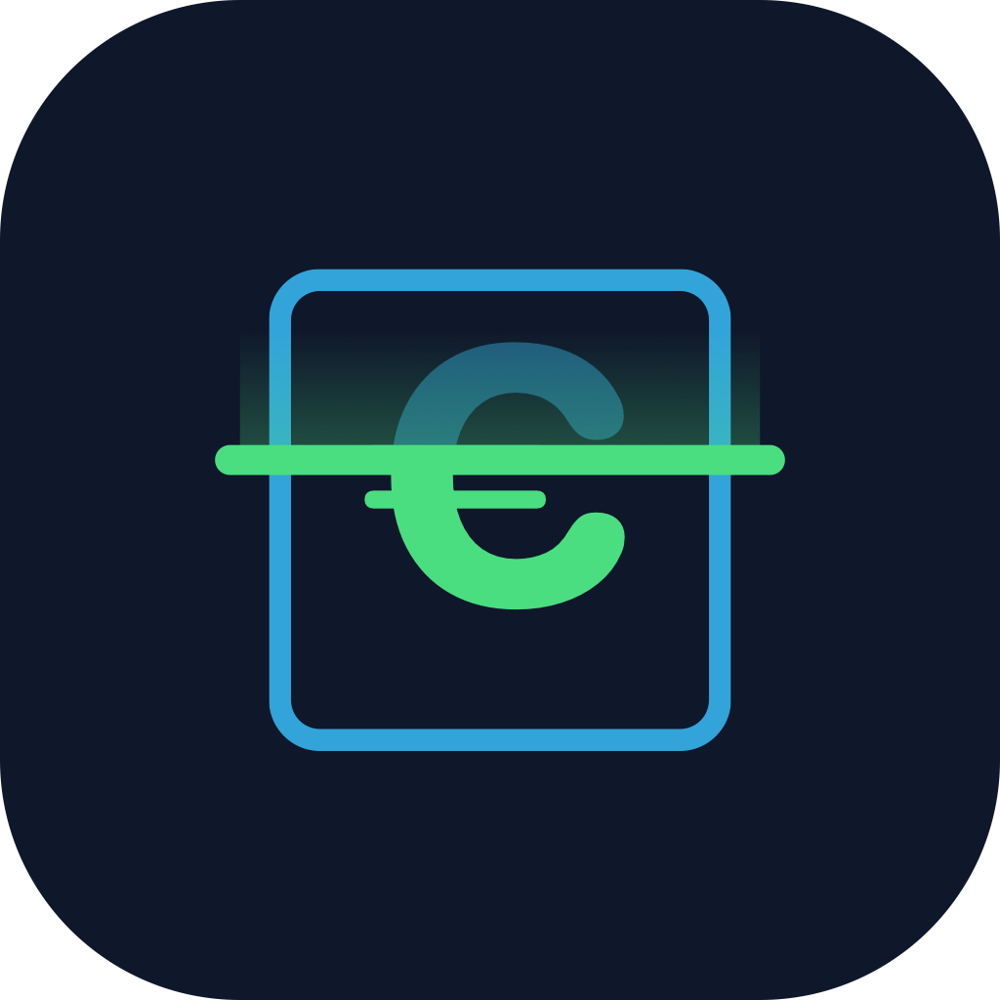

# Rentgen



> **Point your phone at your stuff → an agent identifies each item, prices its resale + rent/day against live web comps → an idle-capital total adds up.**
> Ends on: *"You're sitting on €4,200 doing nothing."* 🎤

**Rentgen** reads as German *Röntgen* (X-ray — sees through your stuff) and as "rent-gen". Built for the {Tech: Europe} × Almedia Hackathon, Berlin.

SDK-first, fully client-side, **zero backend**. The value chain ships as a reusable package (`@rentgen/sdk`); a thin React app (`apps/app`) just launches it.

> **STATUS: working end-to-end.** Tap-to-capture *and* live-pan scanning → OpenAI vision
> classification → Tavily-grounded pricing with real source links → idle-capital total →
> per-item selection → generic listing-export bundle. Runs fully offline on stub adapters
> (`?stub=1`) or live with keys. See `docs/build-notes.md` for lessons learned.

## Quickstart

```bash
npm install          # links the workspaces
npm run dev          # boots the app shell on http://localhost:5173
npm run typecheck    # type-checks both workspaces
```

The app boots with camera capture + results + export bar wired. Append `?stub=1` to the
URL to force the offline stub adapters (no keys, no network — the demo-safe path).
Portability proof: `examples/plain-html/` mounts the same widgets from the built SDK with
zero framework; the Angular recipe is in `packages/sdk/README.md`.

### API keys (when you wire up the real adapters)

```bash
cp apps/app/.env.example apps/app/.env   # then fill in the keys
```

```
VITE_OPENAI_API_KEY=sk-…
VITE_TAVILY_API_KEY=tvly-…
```

Keys are demo-scoped and **rotated after the event** — never commit `.env`.

## Layout

```
packages/sdk/   @rentgen/sdk — value chain + <rentgen-scanner>/<rentgen-results> widgets
apps/app/       thin React (Vite) launcher
docs/           the team's 2nd brain — start at docs/README.md
CLAUDE.md       instructions for Claude Code working in this repo
```

## Scripts

| Command | What |
|---|---|
| `npm run dev` | Run the app (Vite, HMR across packages). |
| `npm run build` | Build the SDK (`dist/` + types) and the app. |
| `npm run typecheck` | Type-check both workspaces. |

## Where to read next

- **[`docs/`](docs/README.md)** — the design, demo script, build order, team split.
- **[`packages/sdk/README.md`](packages/sdk/README.md)** — how to embed the widgets and write adapters.
- **[`docs/brand/`](docs/brand/README.md)** — logo (SVG master + PNG), palette, export how-to.

## Build order (phases are a firewall)

1. **Phase 1 (PoC):** tap → priced items → total, end-to-end. ← *build this first*
2. **Phase 2:** live pan with an in-browser detector — only once Phase 1 demos cleanly.
3. **Phase 3 (stretch):** cognee memory, shareable report card.

Don't start a phase until the previous one demos cleanly. See `docs/specs/`.
