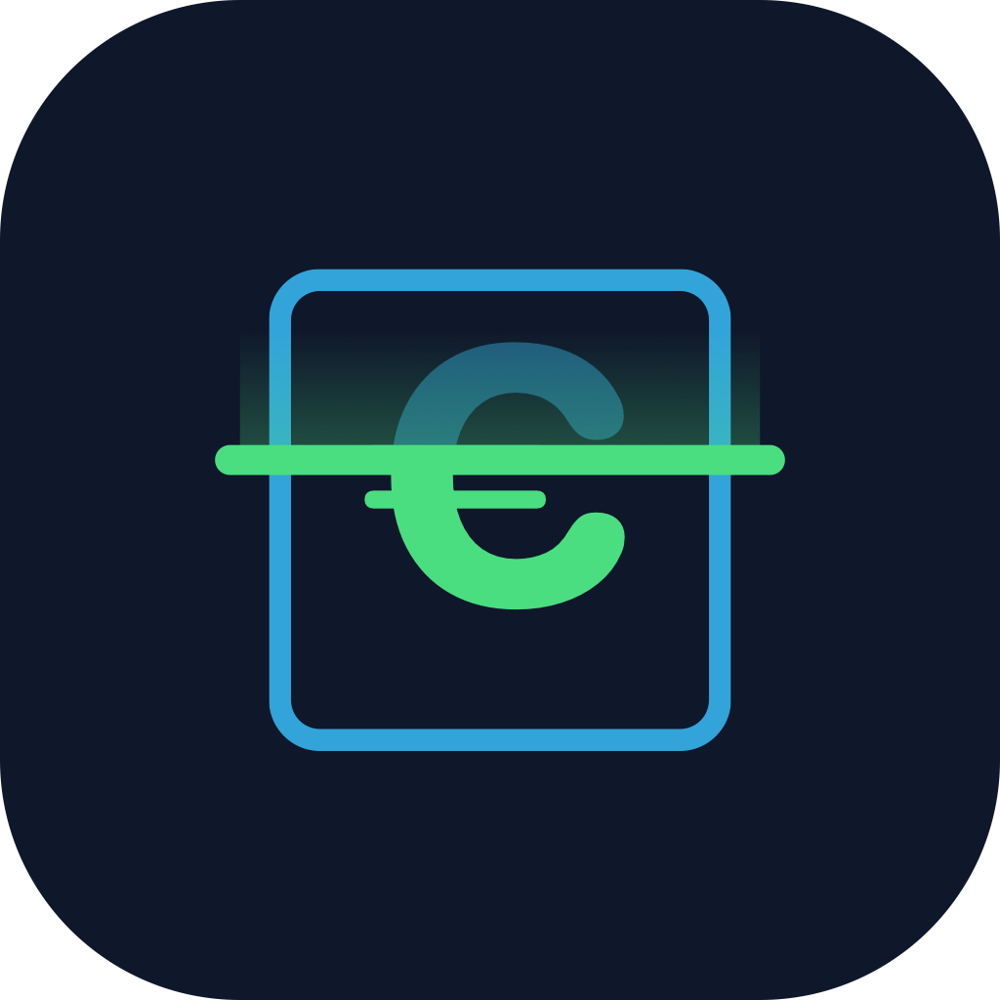

# Rentgen Brand Assets

The hero logo: an X-rayed box revealing the € inside — the brand thesis ("see the hidden value in your stuff") compressed into one glyph.



## Files

| File | Use |
|---|---|
| `rentgen-xray-box.svg` | **Master.** Losslessly scalable — export every other size from this, never upscale the PNG. Navy app-icon background (`rx=24`) built in. |
| `rentgen-xray-box-1024.png` | 1024×1024 raster export — app icon, og-image, slides, Loom title card. |

## Palette

| Color | Hex | Role |
|---|---|---|
| Navy | `#0F172A` | Background / stage |
| X-ray Cyan | `#38BDF8` | Box outline, ghost-€ above the scan line |
| Value Green | `#4ADE80` | Revealed €, scan line, glow trail |

## Anatomy

The scan line splits the €: **above** it a faint cyan "X-ray ghost", **below** it the solid green revealed value — the scan is mid-reveal. The box is a single clean cyan outline (rev. 2 dropped the earlier lid line and swapped the gold € for green).

## Exporting sizes

```bash
# macOS one-liner per size (favicon set: 16/32/64/120/180)
qlmanage -t -s 512 -o . rentgen-xray-box.svg && mv rentgen-xray-box.svg.png icon-512.png
```

Note: the € is a `<text>` glyph in `ui-rounded` — renders identically on macOS/iOS; for pixel-identical output on other platforms, convert the € to a path once (Figma → Outline Stroke) before exporting.
